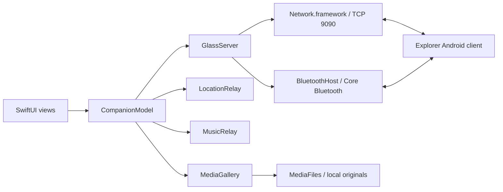

# AnotherGlass

An independent, native iPhone companion for **Google Glass Explorer Edition**. Bring the original Glass back into daily use with text cards, optional GPS, Apple Music controls, and a local photo/video gallery.

SwiftUI on iPhone. A patched Android client on Glass. A direct local connection between them, with no cloud service or account required by this app.

This repository preserves [Alex Smirnov's AnotherGlass](https://github.com/inckie/AnotherGlass) history and Android modules, and adds the iPhone companion plus the Explorer changes it needs. The iPhone app supports Explorer Edition; the inherited Enterprise and Android phone modules remain available for development.

[Get started](#get-started) · [Build](#build-the-iphone-app) · [Architecture](#architecture) · [Protocol](ios/PROTOCOL.md) · [Detailed device setup](ios/README.md)

## What works where

| Capability | Bluetooth LE | Wi-Fi |
| --- | :---: | :---: |
| Approve a Glass connection on iPhone | ✓ | ✓ |
| Glass battery and charging status | ✓ | ✓ |
| Compose and remove text cards | ✓ | ✓ |
| Optional iPhone GPS → Glass | ✓ | ✓ |
| Apple Music playback state and controls | ✓ | ✓ |
| Send Wi-Fi credentials to Glass | ✓ | ✓ |
| Browse Glass photos and video | — | ✓ |
| Download original files | — | ✓ |
| Background companion without GPS | Event-driven BLE | No indefinite background hosting |

Downloaded originals stay available offline. You can play local videos, save to Photos, or share to Files. Downloads do not delete or modify media on Glass.

**Scope:** Music controls use Apple's Music app, not a global media-session API. Text cards are composed in this app; automatic forwarding of other iPhone apps' notifications is not implemented. The iPhone Bluetooth mode is BLE GATT, separate from the Android companion's classic RFCOMM transport.

## Get started

### Requirements

| Component | Requirement |
| --- | --- |
| iPhone | iOS 17 or later; Developer Mode for development installs |
| Mac | Xcode with an iOS SDK/device-support version suitable for your iPhone |
| Project generation | [XcodeGen](https://github.com/yonaskolb/XcodeGen), only when changing `ios/project.yml` |
| Glass | Explorer Edition running Android API 19 or later, with USB debugging enabled |
| Android build | JDK 17; Android SDK platform 37 and build tools 37.0.0 as declared in Gradle |
| Device installation | Android platform tools (`adb`) and an Apple development signing team |

The generated Xcode project is committed. **There are no third-party iOS package dependencies.** The source uses Swift 5 language mode and Apple frameworks.

```sh
git clone --recurse-submodules https://github.com/jonathanbertholet/AnotherGlass.git
cd AnotherGlass
open ios/AnotherGlass.xcodeproj
```

In Xcode, choose the **AnotherGlass** target, select your team under **Signing & Capabilities**, and select your iPhone. Change `com.anotherglass.companion` if your signing setup requires a unique bundle identifier. No team, signing identity, provisioning profile or credentials are committed.

Install the matching Explorer APK using the instructions below. Start the companion on iPhone, connect from Glass, and approve the incoming connection on iPhone. GPS and Music sharing are explicit opt-ins.

### Build the iPhone app

Compile an unsigned arm64 device app from the repository root:

```sh
xcodebuild \
  -project ios/AnotherGlass.xcodeproj \
  -scheme AnotherGlass \
  -configuration Debug \
  -destination 'generic/platform=iOS' \
  -derivedDataPath ios/build/DerivedData \
  CODE_SIGNING_ALLOWED=NO \
  build
```

Output:

```text
ios/build/DerivedData/Build/Products/Debug-iphoneos/AnotherGlass.app
```

An unsigned `.app` is a compilation artifact. To install on an iPhone, use your own development team and build from Xcode. Creating a signed archive or distributable IPA also requires your signing configuration.

When you change targets, source paths or build settings, edit the project specification and regenerate:

```sh
cd ios
xcodegen generate
```

Commit both `project.yml` and the generated `.xcodeproj` when project configuration changes. Build output and personal Xcode state are ignored.

### Build and install the Glass client

The bundled Explorer changes provide BLE, gallery requests, Wi-Fi bootstrap QR codes, initial battery reporting, and card removal. Use this checkout's APK rather than an arbitrary upstream binary.

```sh
# From the repository root
git submodule update --init --recursive
./gradlew :glass-xe:assembleDebug
adb install -r glass-xe/build/outputs/apk/debug/glass-xe-debug.apk
```

The Android application ID is **`com.damn.anotherglass.host`**, despite its activities' `com.damn.anotherglass.glass.host` package names. To open the chooser directly:

```sh
adb shell am start -n \
  com.damn.anotherglass.host/com.damn.anotherglass.glass.host.StartActivity
```

The checked-in GDK jar is a compile-time stub; Glass supplies the runtime implementation. The shared module pins Gson 2.10.1 for API 19 compatibility. Do not upgrade legacy-device dependencies solely to match the newest version.

Gradle also configures the inherited Enterprise gesture module, so initialize submodules even when building only Explorer. Put machine-specific Android SDK paths and optional signing properties in the ignored `local.properties` file. See [the inherited Android notes](docs/UPSTREAM.md) for other modules and signing keys.

## Connect the devices

### Bluetooth LE: the background companion

1. On iPhone's **Glass** tab, select **Bluetooth LE** and tap **Start companion**.
2. On Glass, open AnotherGlass and select **iPhone Bluetooth LE**.
3. Leave the iPhone app open for discovery and tap **Allow Glass** when prompted.
4. Enable GPS or Music sharing only if you want them. GPS is not required for the BLE link.

The iPhone advertises a GATT service; Glass connects as the central. Writes from Glass let iOS wake the peripheral to respond in the background. Initial discovery and rediscovery can require the iPhone app in the foreground. Force-quitting ends the session, and approved sessions are not restored after process termination. Every new connection requires approval.

### Wi-Fi: captures and original downloads

1. Join iPhone and Glass to the same **2.4 GHz WPA2-compatible** network. For Personal Hotspot, enable **Maximize Compatibility**.
2. If Glass needs credentials, open **Setup → Wi-Fi setup QR code** on iPhone and scan it using **AnotherGlass → Scan Barcode** on Glass.
3. On iPhone, select **Wi-Fi** and start the companion.
4. Scan the separate connection QR code on the **Glass** tab, then approve the incoming connection on iPhone.

The credential QR joins a network. The connection QR identifies the iPhone host. They are different codes. On a shared LAN, the older Glass **Wi-Fi** chooser entry may target the router's gateway; scan the explicit iPhone address instead.

Keep the app open for gallery transfers. A Wi-Fi listener alone does not grant indefinite iOS background execution. Background GPS is available as a separate opt-in for people who actually want location sharing.

## Architecture



`CompanionModel` owns the session and connects feature relays to the transport. `GlassServer` owns connection lifecycle, framing, approval, heartbeat and message routing. Views observe these existing owners directly; toggles do not create a parallel source of connection or permission state.

| Path | Responsibility |
| --- | --- |
| `ios/AnotherGlass/App/` | App entry, scene lifecycle, session composition and card deep links |
| `ios/AnotherGlass/Views/GlassDesign.swift` | Shared palette, spacing, panels, buttons, empty states and Explorer vector drawing |
| `ios/AnotherGlass/Views/` | Glass dashboard, card composer, gallery, setup, QR and activity screens |
| `ios/AnotherGlass/Network/` | TCP listener, BLE peripheral, local IPv4 discovery |
| `ios/AnotherGlass/Features/` | Core Location, Music player relay, gallery requests, local media storage |
| `ios/AnotherGlass/Protocol/` | Codable envelopes and wire payloads |
| `ios/project.yml` | XcodeGen project specification |
| `glass-xe/` | Explorer app, BLE central, camera library service and Wi-Fi client |
| `shared/` | Android RPC framing and shared payload models |
| `glass-shared/` | Shared Glass components |
| `mobile/`, `glass-ee/`, `xray/` | Inherited Android phone, Enterprise and supporting modules |
| `python/` | Inherited protocol and APK-serving development utilities |
| `externals/` | Upstream Enterprise sample submodule |

### Wire contract

Both transports carry newline-delimited UTF-8 JSON envelopes:

```json
{"service":"MockGPS","type":"com.damn.anotherglass.shared.gps.Location","payload":{"latitude":50.85,"longitude":4.35,"altitude":30,"speed":0,"bearing":0,"accuracy":5}}
```

The `type` field is the exact Java payload class name. Glass's Gson adapter resolves it with `Class.forName`; renaming a Swift type must not silently change the wire value. Enum strings and service names are case-sensitive. TCP and GATT packet boundaries are not message boundaries.

The gallery uses paginated metadata, small Base64 thumbnails, and a four-chunk original-download pipeline over Wi-Fi. It validates request IDs, revisions, offsets and total length. One original downloads at a time, with cancellation and a 2 GB per-file limit. Interrupted transfers restart; there is no resume protocol. Glass exposes indexed shared photo/video media, not arbitrary paths.

Read **[ios/PROTOCOL.md](ios/PROTOCOL.md)** before changing message models, framing, heartbeat intervals, GATT UUIDs or gallery operations. It contains the service/type table, bounds, payload units and QR formats.

### Transfer performance

iPhone **0.2.1** and Explorer **1.2** remove the inherited 100 ms Wi-Fi polling cycle. Install both apps for the complete update:

- Independent blocking socket reader and writer, with an outgoing queue that wakes immediately when data arrives. Heartbeat waits occur only while idle; reconnect backoff remains separate.
- Up to four 96 KiB reads in flight, with a bounded out-of-order buffer and ordered local file writes. Request IDs, offsets, lengths, total bytes and file revisions are still checked.
- Buffered JSON writes and larger read buffers on Glass, avoiding tiny socket writes while retaining the existing JSON Lines protocol.
- One cached Glass file handle and resolved media record across chunks, invalidated on disconnect, index change, file revision change, errors or idle expiry.
- Direct typed payload decoding on iPhone, incremental line scanning, throttled UI progress updates, and deferred unrelated thumbnails during a download.

The transfer still uses Base64 and the existing single TCP connection. No throughput benchmark or hardware test was run for this update; the speed improvement must be measured on the devices. Protocol compatibility is retained, but an older app retains its own bottlenecks.

### Working on a feature

- **UI:** start in the relevant view and reuse `GlassStyle`, `GlassPage`, `GlassSection` and `GlassPanel`. Preserve Dynamic Type and native navigation. The design uses graphite surfaces, SF typography, a small cyan prism accent and real session data; no external fonts or generated bitmap assets are required.
- **New payload:** add the Swift `Codable` model and the Android counterpart, keep the exact Java class name in the envelope, route it through the existing approved connection, and update the protocol document.
- **Transport:** preserve bounded framing, backpressure and per-connection approval. BLE stays for compact companion messages; bulk media stays on Wi-Fi.
- **iOS permissions:** keep requests attached to explicit feature opt-ins. Update `Info.plist` purpose strings or the privacy manifest when a change requires it.
- **Lifecycle:** use the existing scene callbacks. Do not depend on a foreground timer continuing while iOS suspends the app.

### Local state and privacy

| Data | Lifetime / location |
| --- | --- |
| Card history, activity, Wi-Fi credentials and location state | Memory only; not saved as history |
| Browse thumbnails | Bounded in-memory cache |
| Completed original downloads | `Documents/Glass Media`, exposed through the Files app |
| Download record/thumbnail sidecars | Application Support |
| Saved-to-Photos copies | User's Photos library after add-only authorization |

There is no analytics SDK or backend. Activity entries omit card contents, coordinates and Wi-Fi passwords. Explicitly saving to Photos follows the user's Photos/iCloud settings.

The inherited TCP link is **unencrypted and unauthenticated**. BLE has manual approval but no additional application-level encryption or encrypted GATT requirement. Approval gates private sharing; it is not cryptographic device pairing. Use a trusted network and account for this before extending the protocol to sensitive data.

### Shortcuts

Open this URL to prepare a card:

```text
anotherglass://card?title=Reminder&text=Take%20a%20break
```

The app opens the Cards tab and fills the composer. Sending still requires a tap. Query values should be URL-encoded. This version has no Share extension or all-app notification listener.

## Troubleshooting

| Symptom | First thing to check |
| --- | --- |
| Glass does not find the iPhone over BLE | Install the matching Explorer APK, choose **iPhone Bluetooth LE**, and foreground the iPhone app for discovery |
| Cannot change connection mode | Stop the companion before changing the segmented control |
| Wi-Fi connection targets the router | Scan the iPhone's connection QR rather than choosing gateway-based Wi-Fi on Glass |
| iPhone hotspot address is absent | Enable the manual address in Setup and use the actual gateway reported by Glass |
| Connection waits for approval | Confirm **Allow Glass** on the iPhone that started this session |
| Gallery is unavailable over BLE | Switch to Wi-Fi; local downloads remain available in either mode |
| Gallery is empty | The library reads Android's shared media index; pull to refresh after a capture |
| Socket stops with iPhone locked | Use BLE for background companion traffic; Wi-Fi alone has no background entitlement |
| Music from another app is missing | This relay controls Apple's Music app only |
| ADB reports a signature mismatch | Update using the existing signing key, or explicitly decide whether to remove the old installation and its data |
| Xcode cannot install on a newer iOS device | Use an Xcode version with support for that device's OS and configure your own signing team |

## Build status and testing

The iPhone **0.2.1** transfer update was compiled on **1 November 2026** with **Xcode 26.3 (17C529)** and the **iOS 26.2 SDK**, targeting arm64 / iOS 17 or later, with signing disabled. See the commit history for implementation changes. Compilation is separate from device behavior: no automated suites, simulator runs, visual checks or hardware functional tests were performed for these changes. Device testing is left to the owner.

Explorer **1.2** (version code 3) also compiled successfully with `:glass-xe:assembleDebug` using Gradle 9.6.0. Gradle uses the configured JDK 21 daemon and JDK 17 compilation toolchain. The APK is debug-signed; build output stays out of Git.

The project remains in Swift 5 language mode. Xcode reports existing actor-isolation migration warnings for the `CBPeripheralManagerDelegate` and `CLLocationManagerDelegate` conformances in `BluetoothHost` and `LocationRelay`. Address their delegate execution context before enabling Swift 6 language mode. The App Intents metadata step also reports that there is no AppIntents dependency; this app uses its URL scheme for Shortcuts.

The inherited Android CI configuration remains in `.github/workflows/`. The iPhone app has no added test target or third-party build tooling.

## Credits and license

Application source retains the [MIT license](LICENSE), including Alex Smirnov's upstream copyright. This is an independent project, not an official Google or Apple app. Original MyGlass binaries and assets are not included.

The UI refresh applies the [Unslop](https://github.com/heydamir/unslop) design guidance by **Damir Sokolovsky ([@heydamir](https://x.com/heydamir))**, licensed under [CC BY 4.0](https://creativecommons.org/licenses/by/4.0/). Its guidance was adapted to native SwiftUI: graphite surfaces, restrained color, consistent spacing, readable type, and an Explorer-specific visual. Unslop is design guidance, not a runtime dependency; its license does not replace the application's MIT license.
